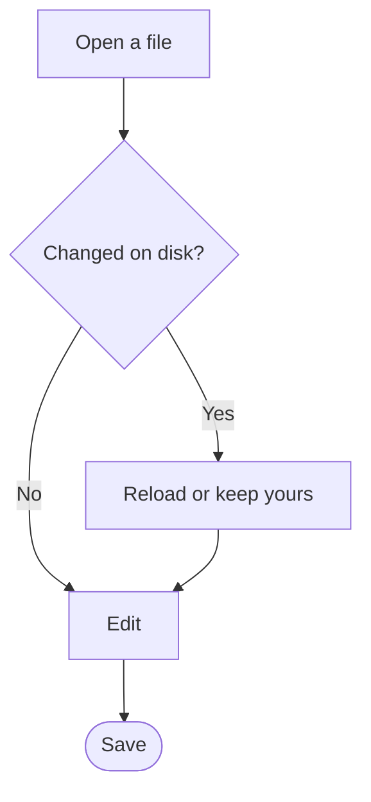
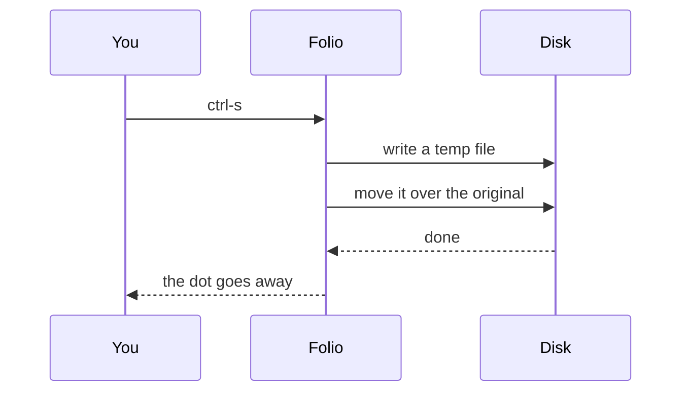

# Welcome to Folio

Folio reads and writes **Markdown**. Type on the left, read on the right: the preview
follows as you write. Switch between *Raw*, *Split* and *Preview* with `ctrl-1`, `ctrl-2`
and `ctrl-3`, and show the outline with `ctrl-shift-o`.

## Writing

- Headings, **bold**, *italic*, ~~strikethrough~~ and `inline code`
- Links like [the CommonMark spec](https://commonmark.org) and bare ones: https://example.com
- Nested lists
  - two spaces per level
  - as deep as you like
1. Numbered lists
2. Keep their numbers

### Tasks

- [x] Open a file with `ctrl-o`
- [x] Edit it live
- [ ] Save with `ctrl-s`

> Quotes stand out from the text.
> > And they nest.

| Key | Action | Notes |
|:----|:------:|------:|
| `ctrl-o` | Open | any `.md` file |
| `ctrl-s` | Save | in place, atomically |
| `ctrl-shift-p` | Palette | every command |

## Math

Inline math sits in the text: the area of a circle is $A = \pi r^2$, and Euler's identity
is $e^{i\pi} + 1 = 0$. Display math gets its own line:

$$
\int_0^1 \frac{x^2}{\sqrt{1 + x}}\,dx = \sum_{n=0}^{\infty} \frac{(-1)^n}{n!}
$$

$$
A = \begin{pmatrix} a & b \\ c & d \end{pmatrix}, \quad
|x| = \begin{cases} x & x \ge 0 \\ -x & x < 0 \end{cases}
$$

## Diagrams





## Code

```v
fn main() {
	name := 'Folio'
	println('Hello from ${name}!') // highlighted by language
}
```

---

Happy writing.
